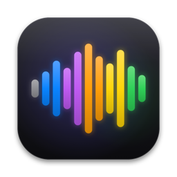
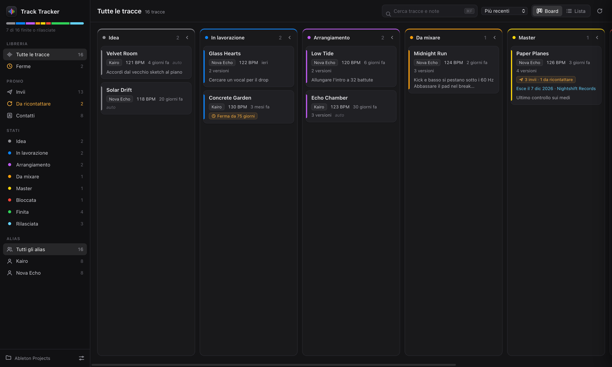
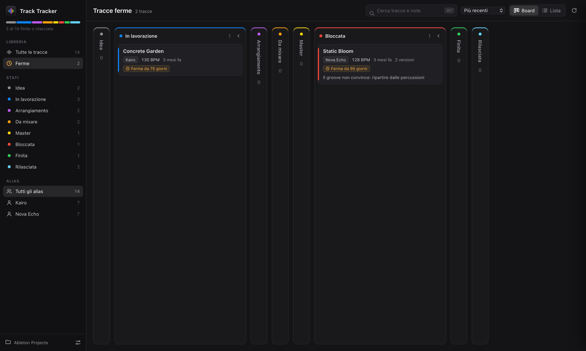
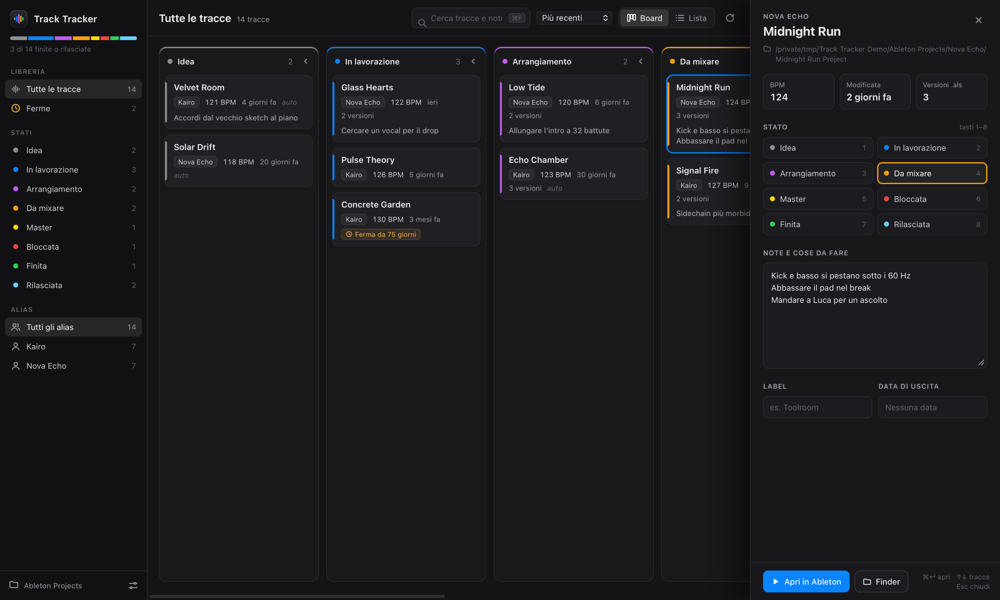
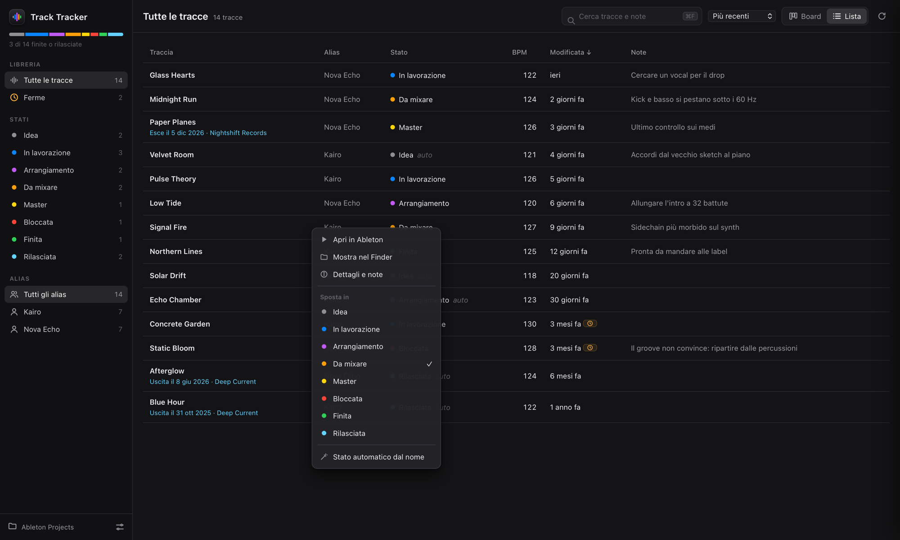
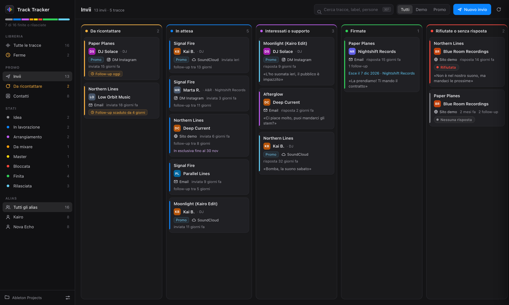
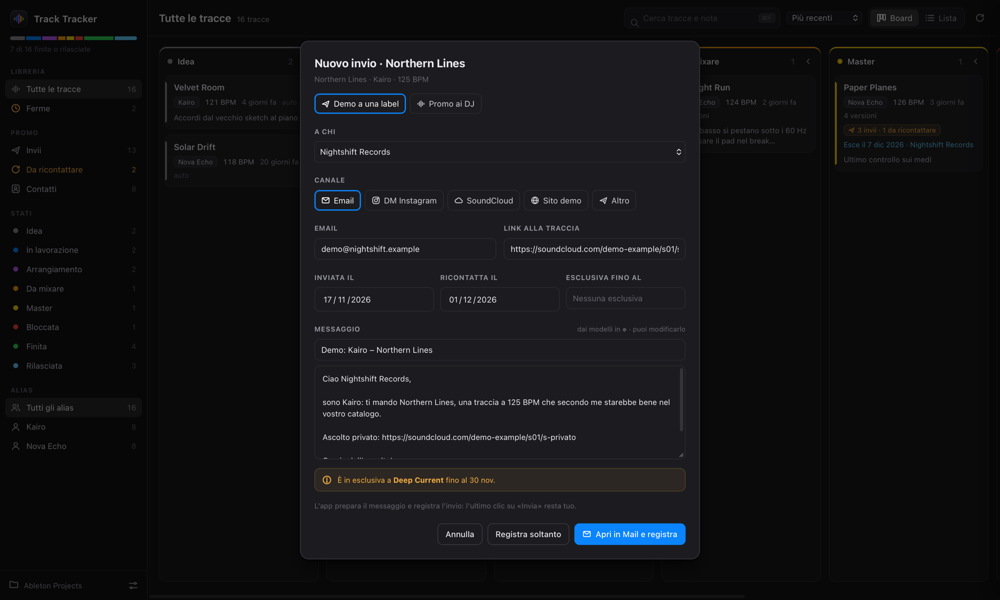
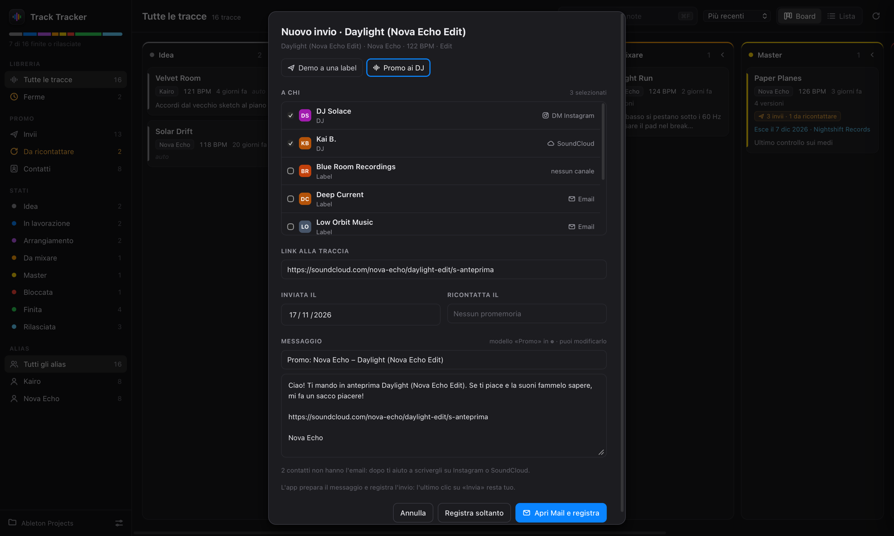
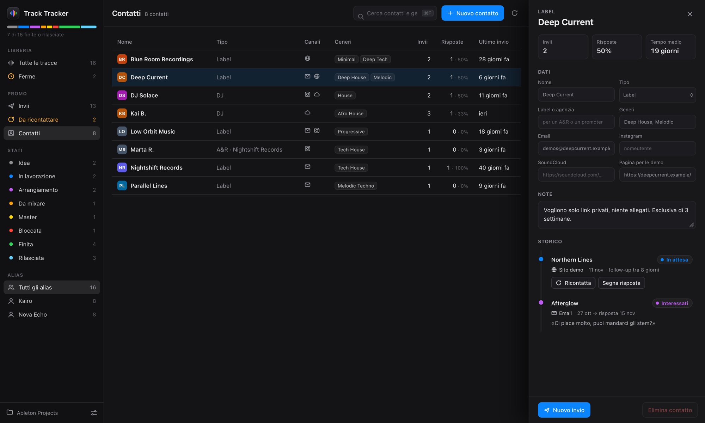
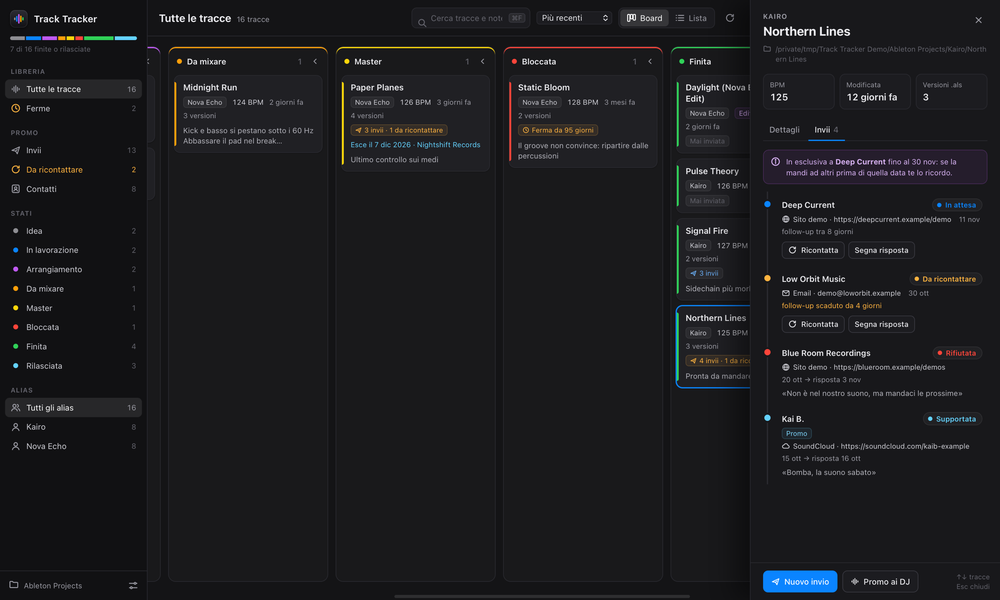

<div align="center">



# Track Tracker

**Sai sempre a che punto è ogni tua traccia.**<br>
Una board per i progetti di Ableton Live, dalla prima idea all'invio alle label: stati, note, BPM, tracce ferme e promo, tutto in locale sul tuo Mac.


<br>



</div>

## Perché



Dopo qualche mese di produzione la cartella dei progetti diventa un elenco infinito di `Qualcosa Project`, `Kick_DONE`, `Idea nuova 3`. Quale traccia aspetta solo il mix? Cosa avevi detto di sistemare nel drop? Quale idea è ferma da mezzo anno?

Track Tracker legge la tua cartella dei progetti Ableton e la trasforma in una board: una colonna per ogni fase, con BPM, note e data di uscita su ogni traccia. Non devi importare niente né cambiare il modo in cui salvi i progetti.

<br clear="right">

## Cosa fa

| | |
|---|---|
| 🗂️ **Trova i progetti da solo** | Ogni cartella con un file `.als` è una traccia, raggruppata per alias (la prima sottocartella). |
| 🎚️ **Otto stati, a colpo d'occhio** | Idea, In lavorazione, Arrangiamento, Da mixare, Master, Bloccata, Finita, Rilasciata. Trascini la card e cambi stato. |
| 🪄 **Stato dedotto dal nome** | `Kick_DONE`, `Groove MIXDOWN`, una cartella `Released`: lo stato iniziale lo capisce da sé. |
| 📝 **Note e cose da fare** | Per ogni traccia: note, label e data di uscita, salvate mentre scrivi. |
| 🥁 **BPM automatico** | Letto direttamente dal file `.als`. |
| ⏳ **Tracce ferme** | Ti mostra quelle che non tocchi da più di 60 giorni (o quanti vuoi tu). |
| ▶️ **Apri in Ableton** | Con un clic dalla card, oppure mostra la cartella nel Finder. |
| 🏷️ **Tag colorati nel Finder** | La cartella di ogni progetto prende il colore del suo stato (si può disattivare). |
| 🔁 **Rinomini senza perdere niente** | Se rinomini o sposti una cartella, stato e note la seguono. |
| ⌨️ **Tutto da tastiera** | Ricerca, frecce per scorrere, tasti 1–8 per lo stato, menu col tasto destro, Annulla. |
| 📨 **Promo: a chi l'hai mandata** | Registra ogni demo alle label e ogni promo ai DJ (email, DM Instagram, SoundCloud, pagine demo) con data, link e risposta. |
| 🎛️ **Edit e uscite fatte da te** | Ogni traccia è Originale, Edit o Remix; puoi segnarla come uscita con una label o pubblicata da te su SoundCloud, con il link. |
| ⏰ **Follow-up ed esclusive** | Ti ricorda chi ricontattare dopo 14 giorni e ti avvisa se una traccia è in esclusiva o l'hai già mandata a quella label. |
| 📇 **Rubrica dei contatti** | Canali, generi, note e percentuale di risposte di ogni label o persona, con tutto lo storico. |

<table>
  <tr>
    <td width="50%"></td>
    <td width="50%"></td>
  </tr>
  <tr>
    <td align="center"><sub>I dettagli di una traccia: stato, tipo (qui un edit), uscita e note</sub></td>
    <td align="center"><sub>La vista Lista e il menu del tasto destro</sub></td>
  </tr>
</table>

## 📨 Promo: dalla traccia finita alla firma

Quando una traccia è pronta comincia l'altra metà del lavoro: mandarla alle label, alle A&R e ai DJ, ricordarsi chi ha risposto e chi va ricontattato. La sezione **Promo** tiene tutto in ordine.



- **Board degli invii**: ogni invio è una card (traccia, destinatario, canale, da quanti giorni) nelle colonne *Da ricontattare*, *In attesa*, *Interessati o supporto*, *Firmate* e *Rifiutate o senza risposta*.
- **Invii di una traccia**: nella scheda *Invii* del pannello di ogni traccia c'è tutto lo storico. Sulla card compare "3 invii · 1 da ricontattare", oppure "Mai inviata" per le tracce finite che non hai ancora mandato a nessuno.
- **Nuovo invio**: scegli il contatto (anche uno nuovo, al volo) e il canale. Il messaggio si compila da un modello con nome, titolo, BPM e link. Con un clic si apre **Mail** con la mail pronta, oppure il messaggio viene **copiato** e si apre la chat di **Instagram**, il profilo SoundCloud o la pagina demo della label.
- **Follow-up**: dopo 14 giorni senza risposta (si cambia in ⚙︎) l'invio passa in *Da ricontattare*. *Ricontatta* prepara il messaggio di sollecito e sposta il promemoria.
- **Esclusive e doppioni**: se una traccia è in esclusiva a una label, o l'hai già mandata a quel contatto, te lo dice prima che tu la mandi.
- **Firmata!**: quando segni un invio come *Firmata*, la traccia passa da sola a *Master* e prende il nome della label.
- **Promo ai DJ**: scegli più DJ insieme e mandi un'anteprima. Chi ha l'email riceve un'unica mail in Ccn (nessuno vede gli indirizzi degli altri); per chi è solo su Instagram o SoundCloud c'è un pulsante che copia il messaggio con il suo nome e apre la chat. L'esito è *Supportata* (la suona) o *Nessuna risposta*. La board si filtra per *Demo* o *Promo*.
- **Edit e uscite fatte da te**: il tipo di traccia (Originale, Edit, Remix) è dedotto dal nome e si cambia con un clic. Nella sezione *Uscita* scegli *Con una label* oppure *Pubblicata da me* (SoundCloud, Bandcamp, YouTube…) con data e link: *Segna come pubblicata* la porta in *Rilasciata*. Se provi a mandare un edit come demo a una label te lo ricordo: di solito non lo possono firmare senza la licenza dell'originale.
- **Rubrica**: per ogni contatto canali, generi, note ("vogliono solo link privati"), percentuale di risposte, tempo medio di risposta e storico.

<table>
  <tr>
    <td width="50%"></td>
    <td width="50%"></td>
  </tr>
  <tr>
    <td align="center"><sub>Demo a una label: messaggio pronto e avviso di esclusiva</sub></td>
    <td align="center"><sub>Promo ai DJ: più contatti insieme, ognuno con il suo canale</sub></td>
  </tr>
  <tr>
    <td width="50%"></td>
    <td width="50%"></td>
  </tr>
  <tr>
    <td align="center"><sub>La rubrica, con la scheda e lo storico di una label</sub></td>
    <td align="center"><sub>Lo storico degli invii di una traccia</sub></td>
  </tr>
</table>

L'app **non manda niente da sola**: prepara il messaggio e registra l'invio, ma l'ultimo clic su «Invia» in Mail o in Instagram resta tuo.

## 🛡️ I tuoi progetti sono al sicuro

- **Non elimina mai niente.** Nel codice non c'è nessuna operazione che cancelli, sposti o rinomini file o cartelle dei progetti.
- **Non modifica i file di Ableton.** I `.als` li legge soltanto, per trovare il BPM.
- **Tutto resta sul tuo Mac.** Niente account, niente cloud: Track Tracker non si collega a internet. Apre Mail, Instagram o una pagina web solo quando premi tu il pulsante di un invio.
- **Non scrive a nessuno al posto tuo.** Prepara i messaggi, ma l'invio vero lo fai tu.
- **Nessun altro può comandarlo.** Risponde solo al tuo computer, e le altre pagine aperte nel browser non possono mandargli comandi.

## Requisiti

- Un Mac con **macOS 13 Ventura** o successivo.
- Gli **strumenti da riga di comando di Apple**, che servono a compilare l'app e contengono anche Python 3. Se non li hai, apri il Terminale e scrivi:

  ```bash
  xcode-select --install
  ```

- **Ableton Live** serve solo per aprire i progetti: la board funziona anche senza.

## Come avviarlo

### L'app per Mac (consigliata)

Apri il Terminale e incolla questi comandi uno alla volta:

```bash
git clone https://github.com/MikeLaboratory/track-tracker.git
```

```bash
cd track-tracker && ./Scripts/build-app.sh
```

```bash
open "Apps/Track Tracker.app"
```

Il secondo comando prepara l'app (ci vuole circa un minuto) e la mette nella cartella `Apps`. Da lì puoi trascinarla in **Applicazioni** o nel Dock.

La prima volta Track Tracker ti chiede **qual è la cartella dei tuoi progetti Ableton** e poi se la ricorda. Se i progetti sono in Documenti, Scrivania o Musica, macOS ti chiederà il permesso di accedervi: rispondi **Consenti**. Dopo ogni nuova compilazione potrebbe chiedertelo di nuovo, ed è normale.

| | |
|---|---|
| <kbd>⌘</kbd> <kbd>O</kbd> | Scegli un'altra cartella dei progetti |
| <kbd>⌘</kbd> <kbd>F</kbd> oppure <kbd>/</kbd> | Cerca nei nomi, nelle note e nelle label |
| <kbd>↑</kbd> <kbd>↓</kbd> | Scorri le tracce e aprine i dettagli |
| <kbd>1</kbd> … <kbd>8</kbd> | Cambia lo stato della traccia aperta |
| <kbd>⌘</kbd> <kbd>↵</kbd> | Apri la traccia in Ableton |
| <kbd>⌘</kbd> <kbd>R</kbd> | Rileggi la cartella |
| <kbd>⇧</kbd> <kbd>⌘</kbd> <kbd>O</kbd> | Mostra la cartella nel Finder |
| <kbd>Esc</kbd> | Chiudi menu, ricerca o pannello |
| Tasto destro | Menu della traccia: apri, mostra nel Finder, sposta in un altro stato |

### Senza app, nel browser

Track Tracker è anche un unico file Python, `track_tracker.py`, che puoi usare senza compilare niente:

```bash
python3 track_tracker.py ~/Music/"Ableton Projects"
```

Si apre il browser su <http://127.0.0.1:8765>. Per chiudere premi <kbd>Ctrl</kbd> <kbd>C</kbd> nel Terminale. Se copi il file direttamente nella cartella dei progetti basta `python3 track_tracker.py`, e la volta dopo un doppio clic su `Avvia Track Tracker.command`, che viene creato al primo avvio.

App e browser usano gli stessi dati: puoi passare dall'una all'altro quando vuoi.

## Aggiornamenti

Per avere l'ultima versione, dalla cartella `track-tracker`:

```bash
git pull && ./Scripts/build-app.sh
```

Cosa è cambiato in ogni versione lo trovi nel [registro delle modifiche](CHANGELOG.md). La versione che stai usando è in **Track Tracker → Informazioni su Track Tracker** e nelle impostazioni (⚙︎).

## Cosa scrive sul tuo computer

| Cosa | Dove | Quando |
|---|---|---|
| `_tracker_data.json`: stati, note, label, date e impostazioni | nella cartella dei progetti | quando cambi qualcosa nella board |
| `_tracker_promo.json`: contatti, invii e modelli dei messaggi | nella cartella dei progetti | quando registri un invio o modifichi un contatto |
| Tag colorati del Finder | sulle cartelle dei progetti | quando cambi stato (si disattiva in ⚙︎) |
| La cartella scelta | nelle preferenze dell'app (`com.tracktracker.app`) | quando la scegli |
| `Avvia Track Tracker.command` | nella cartella dei progetti | solo usando il file Python dal Terminale, al primo avvio |
| L'app compilata | in `Apps/` dentro `track-tracker` | quando lanci `build-app.sh` |

`_tracker_promo.json` contiene email e profili di altre persone: se condividi la cartella dei progetti con qualcuno (per esempio su un disco in comune o in cloud), ricordati che dentro c'è anche la tua rubrica.

I tag del Finder usano questi colori. Il Finder ne ha solo 7, quindi "Idea" è un tag senza colore:

| Idea | In lavorazione | Arrangiamento | Da mixare | Master | Bloccata | Finita | Rilasciata |
|---|---|---|---|---|---|---|---|
| nessuno | blu | viola | arancio | giallo | rosso | verde | grigio |

<details>
<summary><b>Come riconosce i progetti e gli stati</b></summary>

<br>

- Ogni cartella che contiene almeno un file `.als` è un progetto. Se ce ne sono diversi, il principale è quello modificato più di recente.
- La prima sottocartella dentro la cartella dei progetti è l'**alias** (`Ableton Projects/NomeArtista/Traccia Project`). I progetti messi direttamente nella cartella principale finiscono in "Senza alias".
- Le cartelle di servizio di Ableton (`Backup`, `Samples`, `Recorded`, `Freeze`…) vengono saltate.

Finché non scegli tu uno stato, lo deduce dal nome della cartella (sulla card compare la scritta *auto*):

| Nel nome compare… | Stato |
|---|---|
| `RELEASED`, `RILASCIATA`, `USCITA`, o la cartella è dentro `Released` / `Rilasciate` / `Uscite` | Rilasciata |
| `BLOCKED`, `BLOCCATA`, `STUCK` | Bloccata |
| `MASTER` | Master |
| `DA MIX`, `MIXARE`, `TO MIX`, `MIXDOWN` | Da mixare |
| `FINITA`, `DONE`, `FINISHED`, `CONCLUSA` | Finita |
| `ARRANG…` | Arrangiamento |
| `IDEA`, `SKETCH`, `BOZZA` | Idea |
| nient'altro | In lavorazione |

Maiuscole e minuscole non contano, e funzionano anche separatori come `_` o `-`. Queste parole vengono tolte dal nome mostrato nella board.

Se rinomini o sposti la cartella di un progetto, Track Tracker la riconosce dalla sua identità sul disco. Se la copi su un altro disco, la ritrova dal nome del file `.als` principale, ma solo se nessun altro progetto ha un file con lo stesso nome.

</details>

<details>
<summary><b>Come è fatto</b></summary>

<br>

- **`track_tracker.py`**: il cuore. Un unico file Python senza librerie esterne: legge le cartelle, salva i dati e serve l'interfaccia (HTML, CSS e JavaScript contenuti nel file) su `127.0.0.1`.
- **`Sources/TrackTracker/App.swift`**: l'app per Mac. Una finestra con WebKit che avvia `track_tracker.py` in modalità app, su una porta scelta dal sistema; lo script si chiude quando chiudi l'app.
- **`Scripts/`**
  - `build-app.sh` compila e firma l'app per il tuo Mac (firma locale, non una notarizzazione Apple);
  - `make-icon.swift` disegna l'icona;
  - `release.sh` pubblica una nuova versione;
  - `make-screenshots.sh`, `make-demo.py` e `snapshot.swift` rigenerano gli screenshot di questa pagina con progetti inventati.
- **Versioni**: numeri `MAGGIORE.MINORE.CORREZIONE`, scritti solo in `__version__` dentro `track_tracker.py`. Per pubblicarne una nuova, scrivi le modifiche sotto "Non rilasciato" nel [CHANGELOG](CHANGELOG.md) e lancia `./Scripts/release.sh patch` (oppure `minor` o `major`): aggiorna numero, registro e badge, poi crea il commit e il tag `vX.Y.Z`.
- **Controllo dell'app**: `"Apps/Track Tracker.app/Contents/MacOS/TrackTracker" --check-launch` verifica che l'app si avvii, carichi la board e salvi.

</details>

## Licenza

[MIT](LICENSE) © 2026 MikeLaboratory. Puoi usare, modificare e condividere Track Tracker liberamente, anche in altri progetti, purché lasci la nota di copyright. È fornito così com'è, senza garanzie.
